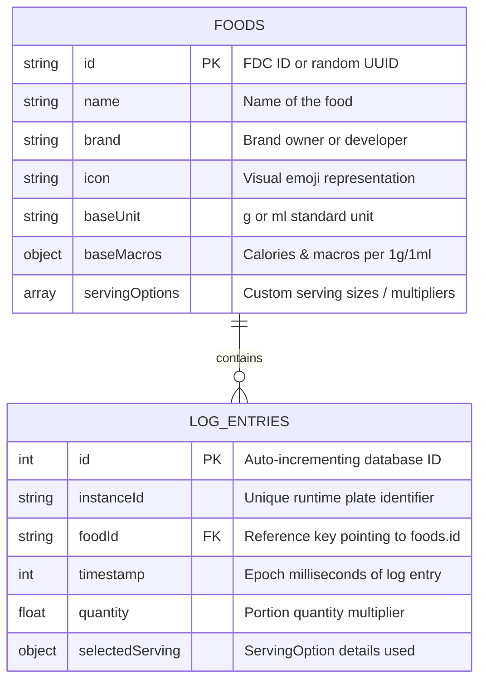

# whoa-a-kcal-trackr

A simple, offline-first calorie and macronutrient tracker designed for rapid logging.It features local database persistence via Dexie/IndexedDB, USDA FoodData Central integration, and a mobile-optimized, gesture-driven user interface.

---

## Key Features

*   **Offline-First Architecture**: Powered by [Dexie.js](https://dexie.org/) and **IndexedDB** for local data persistence. Logs and food definitions are stored on-device, offering instant loading and offline usability.
*   **USDA FoodData Central Integration**: Search millions of global food items dynamically via a debounced API client. Search results automatically map USDA nutritional profiles to the application's local format.
*   **Staged Logging ("The Plate")**: A dedicated workspace to compile, review, and customize food portions, serving multipliers, and cumulative macros before final commitment to the daily log.
*   **Intelligent Macro Scaling**: Real-time macronutrient calculations (calories, protein, fat, carbohydrates) scaled dynamically based on serving multipliers and quantities.
*   **Custom Gesture Pickers**: Native-feeling wheel picker inputs for date and time configuration, custom-built using physics-based spring animations from [Motion](https://motion.dev/).
*   **Modern Dark Mode Aesthetic**: Premium UI built with [Tailwind CSS v4](https://tailwindcss.com/) featuring glassmorphic navigation headers, card-based layouts, and smooth gesture animations.

---

## Tech Stack & Dependencies

| Category | Technology / Library | Version | Purpose |
| :--- | :--- | :--- | :--- |
| **Core UI** | [React](https://react.dev/) | `^19.2.5` | Component rendering engine |
| **Build Tool** | [Vite](https://vite.dev/) | `^8.0.9` | Fast compiler and development server |
| **Language** | [TypeScript](https://www.typescriptlang.org/) | `~6.0.2` | Static typing for entities, hooks, and helpers |
| **Styling** | [Tailwind CSS](https://tailwindcss.com/) | `^4.2.3` | Modern utility CSS styling (v4) |
| **Local Database** | [Dexie.js](https://dexie.org/) | `^4.4.2` | IndexedDB abstraction layer |
| **DB Hooks** | [Dexie React Hooks](https://dexie.org/) | `^4.4.0` | React bindings for live database queries |
| **Animations** | [Motion](https://motion.dev/) | `^12.38.0` | Gesture handling and screen transition animations |

---

## Directory Structure

```text
whoa-a-kcal-trackr/
├── src/
│   ├── assets/                  # SVG, static icons, and design resources
│   ├── components/              # Interactive user interface elements
│   │   ├── AddFoodButton.tsx       # Button to open the search and logging workspace
│   │   ├── DateNavigator.tsx       # Header controls to switch between calendar days
│   │   ├── DateSelectModal.tsx     # Time/date selector overlay with custom wheel columns
│   │   ├── DateSelectPill.tsx      # Toggled pill showing the active logging timestamp
│   │   ├── DayTotals.tsx           # Progress dashboard presenting aggregated macros
│   │   ├── DetailMacroColumn.tsx   # Visual percentage/gram column bar indicator
│   │   ├── FoodCard.tsx            # Card component displaying individual food names and macros
│   │   ├── FoodDetailModal.tsx     # Serving editor showing interactive macro percentages
│   │   ├── FoodLog.tsx             # Hourly group container for consumed food lists
│   │   ├── HourTotalsHeader.tsx    # Header for hourly buckets displaying hourly totals
│   │   ├── LogFoodButton.tsx       # Floating action button to commit current plate staging
│   │   ├── PlateDetailScreen.tsx   # Detailed list view of food currently on the staging plate
│   │   ├── PlatePill.tsx           # Pill-badge showing quantities of items on the plate
│   │   ├── SearchScreen.tsx        # Search interface blending local DB foods and USDA results
│   │   └── WheelColumn.tsx         # Swipe/drag-to-scroll custom selector columns
│   ├── constants/               # Global configuration tables
│   │   ├── date-time.ts            # Hours (1-12) and Periods (AM/PM) maps
│   │   └── units.ts                # Gram & milliliter multiplier mappings (cups, oz, kg, etc.)
│   ├── data/                    # Local storage helper assets
│   │   └── mockDatabase.ts         # Preloaded seed items for instant demonstration
│   ├── hooks/                   # Business logic and query separation layers
│   │   ├── useFoodSearch.ts        # Combines local database search and USDA API results
│   │   ├── useLogs.ts              # IndexedDB date queries, parsing, and commit mutations
│   │   ├── usePlate.ts             # Workspace state tracker (adding, editing, cleaning plate)
│   │   └── useSelectedDate.ts      # State manager for dashboard date transitions
│   ├── types/                   # Unified TypeScript definitions
│   │   └── food.ts                 # Interfaces for ServingOption, Food, and LogEntry
│   ├── utils/                   # Reusable functions and formatting calculations
│   │   ├── dateUtils.ts            # Time range generator, hour grouping, and formatters
│   │   ├── dbUtil.ts               # Database check and auto-seeding routine
│   │   ├── foodDataCentralUtils.ts # USDA API search queries and nutrient parsers
│   │   ├── iconUtils.ts            # Emoji selector based on text matches
│   │   ├── logMacroUtils.ts        # Nutrient calculators for single/multiple entries
│   │   └── stringUtils.ts          # Word casing formatting and unit display strings
│   ├── db.ts                    # Dexie class setup establishing local table structure
│   ├── App.tsx                  # Root state layer, layout container, and modal routers
│   ├── main.tsx                 # Core application entrypoint
│   └── index.css                # Global styling entries importing Tailwind v4
```

---

## Database Schema (IndexedDB)

The project leverages IndexedDB via **Dexie.js** using a two-table design.



### Table Definitions
*   **`foods`**: Caches food definitions (seeded locally and imported from USDA search calls). Primary key is `id`, indexed on `name`.
*   **`logEntries`**: Stored logs of consumed foods with portion sizes and timestamps. Primary key is an auto-incrementing integer `id`, indexed on `foodId` and `timestamp`.

---

## External API Integration

Food items not cached locally are queried on-demand from the **USDA FoodData Central API**.

*   **API Endpoint**: `https://api.nal.usda.gov/fdc/v1/foods/search`
*   **Authentication**: Configured via `VITE_USDA_API_KEY` in your environment.
*   **Conversion Math**:
    *   USDA stores raw nutrient values **per 100g or 100ml**.
    *   `foodDataCentralUtils.ts` automatically converts nutritional stats to a **per 1g/ml** unit base by dividing by `100`.
    *   Macronutrient calculations scale the base values according to servings:
        $$\text{Calories / Macros} = \text{Base Macro} \times \text{Serving Multiplier} \times \text{Quantity}$$

---

## Getting Started

### Prerequisites
*   [Node.js](https://nodejs.org/) (v18.x or later recommended)
*   A registered key for the [USDA FoodData Central API](https://fdc.nal.usda.gov/api-key-signup.html)

### Installation

1.  **Clone the repository**:
    ```bash
    git clone https://github.com/your-username/whoa-a-kcal-trackr.git
    cd whoa-a-kcal-trackr
    ```

2.  **Install dependencies**:
    ```bash
    npm install
    ```

3.  **Configure environment variables**:
    Create a `.env` file in the project root:
    ```env
    VITE_USDA_API_KEY=YOUR_USDA_API_KEY_HERE
    ```

4.  **Start the development server**:
    ```bash
    npm run dev
    ```

5.  **Build for production**:
    ```bash
    npm run build
    ```

---

## Development Guidelines & Design Patterns

*   **Reactive State Streams**: Always access IndexedDB queries via the `useLiveQuery` hook. React components will automatically re-render when the database is modified from any separate views.
*   **Plate Instance Identifiers**: Staged food items on the "Plate" are assigned a temporary `instanceId` (using `crypto.randomUUID()`). This allows users to add multiple distinct servings of the exact same food item (same `foodId`) with different weights or measurements simultaneously without conflicts.
