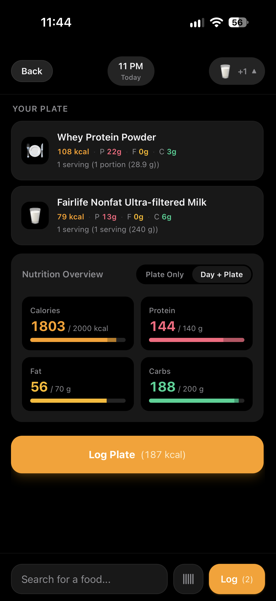
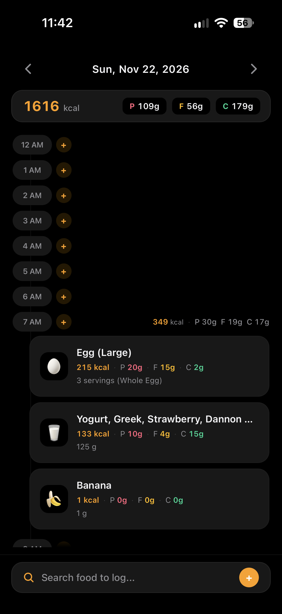
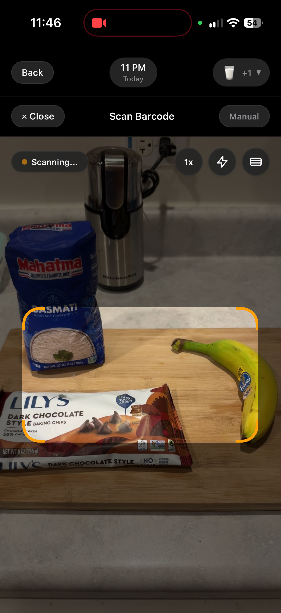
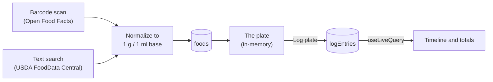

# whoa, a kcal trackr!

a calorie and macro tracker that works offline, has no accounts or ads, and keeps your data on your own device

**[try the live demo](https://whoa-a-kcal-trackr.vercel.app/)** · [features](#what-it-does) · [how it's built](#how-its-built) · [run it locally](#run-it-locally)

<p align="center">
  
</p>

---

## why I built it

most nutrition apps ask you to make an account, pay a subscription, or sit through ads, all while making sacrifies on features, speed, or quality. this project was initially started to get me out of that cycle, but I figured I'd share it for those who feel the same way

- **it works offline** Foods and logs are stored in your browser with IndexedDB. No account, no tracking, and it keeps working when you lose service
- **you build a meal before you log it** Instead of saving ingredients one at a time, you put them on a plate, adjust portions, see how the numbers add up, and log the whole thing at once
- **the food data is solid** Search whole foods through the USDA database, or scan the barcode on packaged groceries using Open Food Facts
- **it's made for phones** A 24-hour timeline, scroll wheels for date and time, and a custom number pad so you can log foods in typical food units (even fractions!)

---

## what it does

<table>
  <tr>
    <td align="center"><br><sub>the plate</sub></td>
    <td align="center"><br><sub>24-hour timeline</sub></td>
    <td align="center"><br><sub>barcode scanner</sub></td>
  </tr>
</table>

### the plate
- add several foods to a temporary plate before anything touches your day
- change quantities and serving units (grams, ounces, cups, tablespoons, or packaging sizes like "1 container")
- flip between **Plate Only** and **Day + Plate** to see what the meal adds up to and how it fits into your day so far
- log the whole plate in one tap, or edit a meal you already logged

### a 24-hour timeline
- your day laid out hour by hour, 12 AM to 11 PM, with no fixed breakfast, lunch, and dinner boxes. that suits shift work, fasting windows, and late dinners
- the current hour is highlighted, and tapping **+** on any hour adds food straight to that slot
- hourly and daily totals update as you log

### finding food
- **barcode scanning:** reads barcodes with your phone's camera, with zoom and flashlight controls, and looks packaged foods up in Open Food Facts
- **USDA FoodData Central search:** whole foods and raw ingredients, with debounced search so it isn't firing a request on every keystroke
- **everything is cached and editable:** foods you've used or created stay available offline
- **no image assets:** each food gets an emoji from a keyword-based classifier, so the app looks right without needing the network

### install it like an app
open the demo in *Safari* on iPhone, tap **share**, then **add to home screen**. it runs full screen as a PWA, with safe-area handling for the notch and dynamic island

---

## how it's built

A few of the problems I ran into and what I did about them.

### local first, with live queries
Everything lives in IndexedDB through Dexie.js. Components subscribe with `useLiveQuery`, so any time a log is created, edited, or deleted, the timeline and totals update on their own. There is no global state library and no manual refetching, and nothing waits on a network.

### one unit for every food
USDA and Open Food Facts both report nutrition per 100 g or 100 ml, in different formats. On import, everything is converted to a base of 1 g or 1 ml, and each serving option just stores a multiplier:

```
total = base value × serving multiplier × quantity
```

Open Food Facts entries sometimes have macros but no calorie value. In that case the app works out calories from the macros using the standard 4 / 4 / 9 energy factors for protein, carbs, and fat.

### the plate and instance ids
Each item on the plate gets a temporary `instanceId` from `crypto.randomUUID()`. That lets the same food appear twice with different amounts (olive oil for cooking and olive oil in the dressing, for example) without key conflicts or shared state.

### barcode scanning with a fallback
The scanner uses the browser's native `BarcodeDetector` when it exists, which is faster and easier on battery. When it doesn't, it falls back to a software decoder built on `@zxing/library`. Torch and zoom controls show up only when the device supports them, and the camera stream is shut down explicitly on close so iOS doesn't leave the camera indicator on.
Code: [`BarcodeScannerModal.tsx`](src/components/BarcodeScannerModal.tsx)

### a custom number pad
On an iOS web app, the system keyboard resizes the viewport and pushes the layout around. So the quantity fields use their own in-app keypad, with the system keyboard suppressed. The quantity parser accepts whole numbers, decimals, and fractions: `2`, `1.75`, `1/3`, `1 1/2`.
Code: [`NumericKeyboard.tsx`](src/components/NumericKeyboard.tsx), [`stringUtils.ts`](src/utils/stringUtils.ts)

### a "now" marker without polling
Rather than checking the time on an interval, the timeline schedules a single timer for the next top of the hour and moves the current-hour marker when it fires.

### data model
Two IndexedDB tables: `foods` (normalized foods and their serving options) and `logEntries` (timestamped diary entries).

<details>
<summary>data flow diagram</summary>



</details>

### design
Pure black background for OLED screens, neutral grays with no blue tint, soft pastel colors for the calorie, protein, fat, and carb accents, and two corner radii used consistently across the app.

---

## tech stack

| | |
| :--- | :--- |
| **App** | React 19, TypeScript, Vite |
| **Styling** | Tailwind CSS v4 |
| **Storage** | Dexie.js on IndexedDB |
| **Animation** | Motion |
| **PWA** | Vite PWA (Workbox service worker) |
| **Scanning** | Native `BarcodeDetector`, `@zxing/library` fallback |
| **Food data** | USDA FoodData Central, Open Food Facts |

---

## run it locally

You'll need Node.js 18 or newer and a free [USDA FoodData Central API key](https://fdc.nal.usda.gov/api-key-signup.html). Open Food Facts doesn't need one.

```bash
git clone https://github.com/jackbuoy/whoa-a-kcal-trackr.git
cd whoa-a-kcal-trackr
npm install
```

Create a `.env` file in the project root:

```env
VITE_USDA_API_KEY=your_usda_api_key_here
```

Then:

```bash
npm run dev     # start the dev server
npm run build   # production build
```

---

## good to know

- Your data lives in your browser, so clearing site data for the app will erase your logs.
- Food coverage depends on USDA and Open Food Facts. Some packaged items have incomplete data.